<h1 align="center">Label Quality Auditor</h1>
<p align="center"><b>Can an AI automatically find the wrong labels in self-driving-car training data?</b><br>
I built a pipeline that flags suspicious bounding-box labels, then measured how well it works by breaking labels on purpose so the right answers are known.</p>

<p align="center">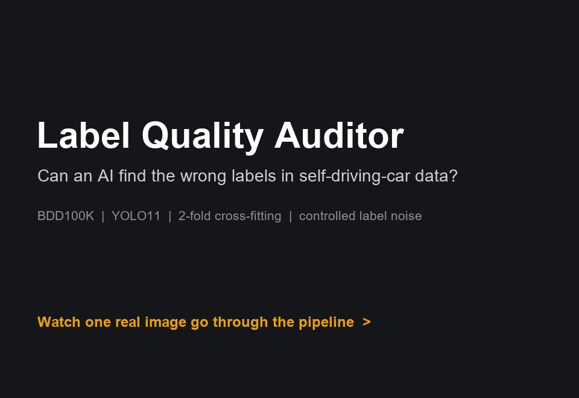</p>

<p align="center"><sub>Above: one real photo from the project. Green = correct labels, red = labels I corrupted, blue = what the AI sees, yellow = labels the auditor flags.</sub></p>

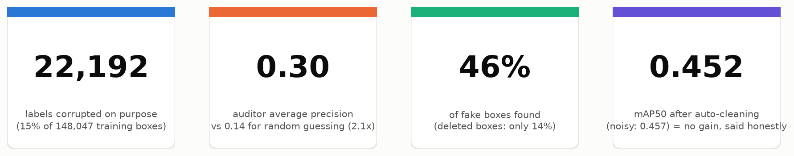

## In 60 seconds

- **The problem.** A self-driving perception model learns from images where people drew boxes around cars, pedestrians and signs. People make mistakes, and bad labels quietly make the model worse. Nobody can re-check millions of boxes by hand.
- **What I built.** An *auditor*: a detector trained with cross-fitting that re-looks at every labelled box and says "I disagree with this label, and here is why" (wrong class / bad box / fake box / missing box).
- **How I tested it honestly.** I corrupted 15% of the training labels on purpose (22,192 boxes in 4 ways), kept a secret answer key, and graded the auditor against it.
- **What I found.** The auditor is **2.1x better than random guessing** (average precision 0.30 vs 0.14). It finds 46% of fake boxes, 46% of bad boxes and 35% of wrong classes at a review budget equal to the number of errors, but only 14% of deleted boxes.
- **What did not work (and I say so).** Automatically fixing/removing flagged labels did **not** improve the final detector (mAP50 0.452 vs 0.457). Section 6 explains why.
- **Skills shown:** Python, PyTorch/Ultralytics YOLO, computer vision, experiment design, controlled ablations, honest evaluation, data-quality triage, reproducible pipeline (one script) with an automatic claim verifier (`verify_claims.py`, 48 checks).

## How the project works

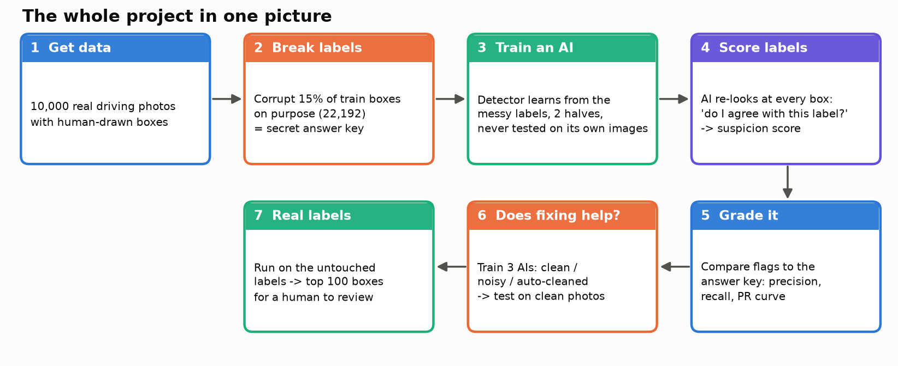

### 1. The data

I used **BDD100K**, a public driving dataset: 10,000 real street photos with boxes for 10 classes (cars, trucks, buses, people, riders, bikes, motorcycles, traffic lights, traffic signs, trains). I split it once, with a fixed random seed, into **8,000 training photos** and **2,000 validation photos**. The validation photos are kept clean and are never touched.

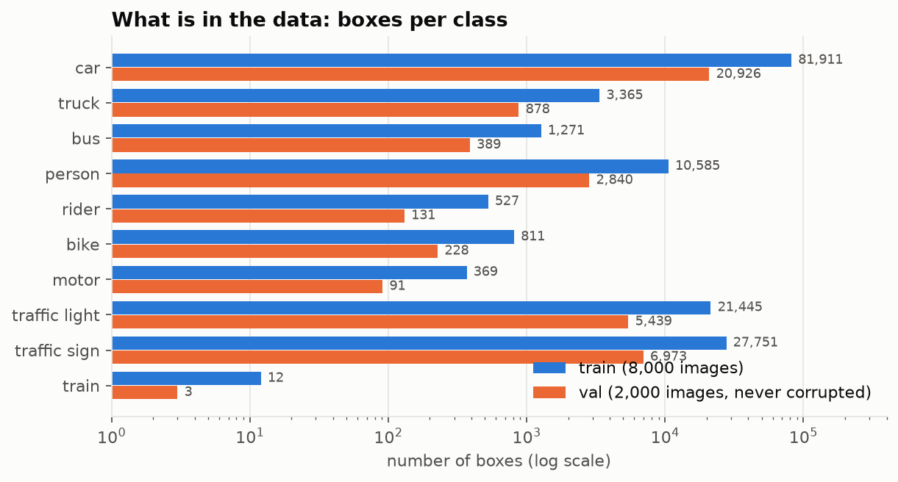

| class | train boxes | val boxes |
|---|---|---|
| car | 81,911 | 20,926 |
| truck | 3,365 | 878 |
| bus | 1,271 | 389 |
| person | 10,585 | 2,840 |
| rider | 527 | 131 |
| bike | 811 | 228 |
| motor | 369 | 91 |
| traffic light | 21,445 | 5,439 |
| traffic sign | 27,751 | 6,973 |
| train | 12 | 3 |

*Cars, traffic signs and traffic lights dominate; `train` (the railway kind) has only 12 training boxes, so results for it mean nothing.*

### 2. Breaking labels on purpose (so we know the right answers)

If I only had the original labels I could never know whether the auditor was right. So I made a **copy** of the training labels and corrupted 15% of the boxes in four ways. Every change is written to `results/noise_manifest.csv`, which is the answer key.

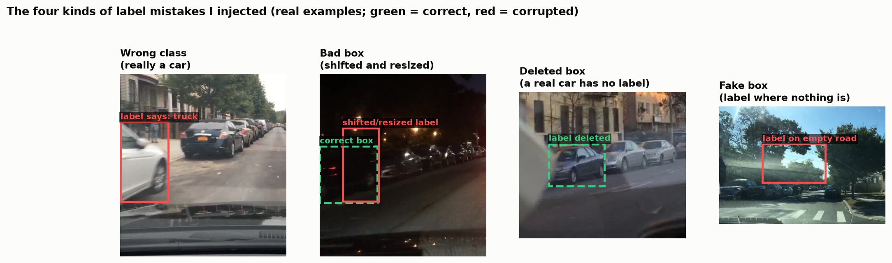

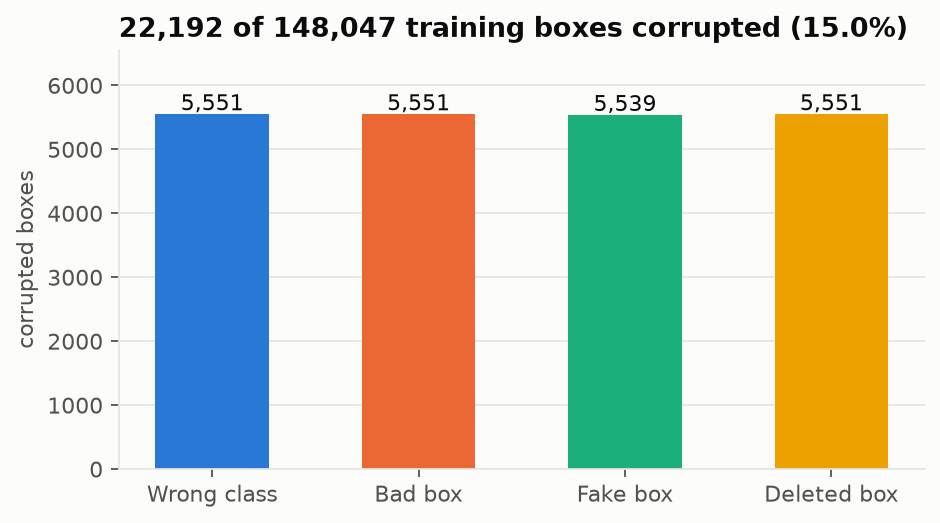

### 3. Training the detector (with a trick: cross-fitting)

I fine-tuned a small pretrained **YOLO11s** object detector on the *noisy* labels. There is one trap: a model that trained on a wrong label can memorise it and agree with it, which hides the error. So I split the training photos in two halves. One detector learns on half A and judges half B; another learns on B and judges A. **No photo is ever judged by a model that trained on it.**

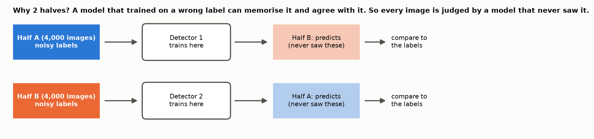

Real training curves for the two detectors (30 epochs each, logged to `results/logs/`). Final accuracy on the clean validation photos: mAP50 0.425 and 0.417. These are small models trained on only 4,000 photos each, so they are modest judges.

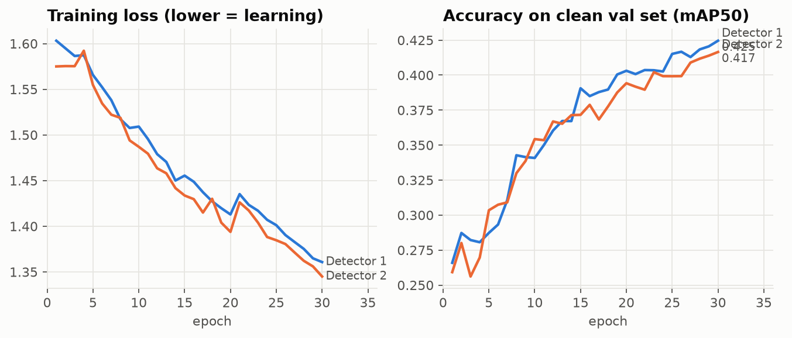

### 4. Scoring every label

For each training box, the auditor compares the label with what the held-out detector predicts at that spot and produces a **suspicion score** (0 to 1) plus a **reason**:

| Reason | What it means in plain words |
|---|---|
| Wrong class | The AI confidently sees a *different* class on this box (label says truck, AI says car). |
| Bad box | The AI sees the same kind of object, but the box only partly overlaps it. |
| Fake box | The AI sees nothing at all under this label. |
| Missing box | The AI confidently sees an object that has *no* label. |

I built two versions. **v1** used the raw scores; the "nothing here" score drowned out the rest. **v2** converts each score into a percentile among boxes of the same class and size, so the four reasons are comparable. v2 uses no information from the answer key, but I *did* choose it after looking at v1's results, so I report both.

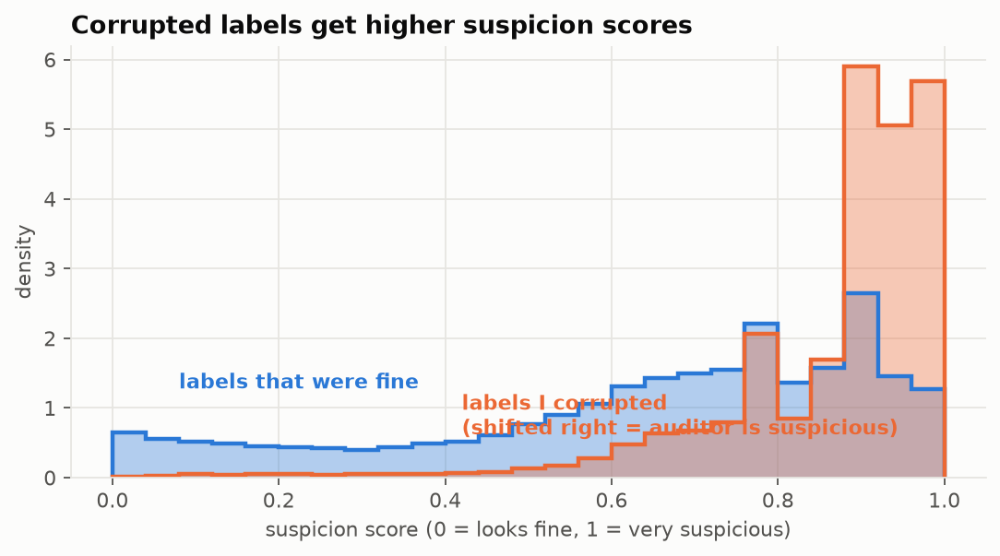

### 5. Grading the auditor against the answer key

Plain-language metrics guide:

- **Precision@k:** of the first *k* boxes the auditor flags, what share are really errors?
- **Recall@k:** of all 22,192 injected errors, what share are inside those first *k*?
- **PR curve:** precision vs recall as you read further down the list. Higher and further right is better.
- **Average precision (AP):** one number summarising the PR curve. Random guessing gets 0.144 here.

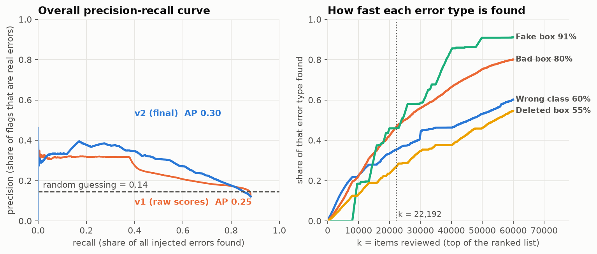

| k (boxes a human would review) | precision | recall |
|---|---|---|
| 100 | 32.0% | 0.1% |
| 500 | 30.0% | 0.7% |
| 1,000 | 28.9% | 1.3% |
| 5,000 | 33.3% | 7.5% |
| 10,000 | 39.0% | 17.6% |
| 22,192 | 35.5% | 35.5% |
| 30,000 | 32.5% | 43.9% |
| 50,000 | 27.0% | 60.8% |

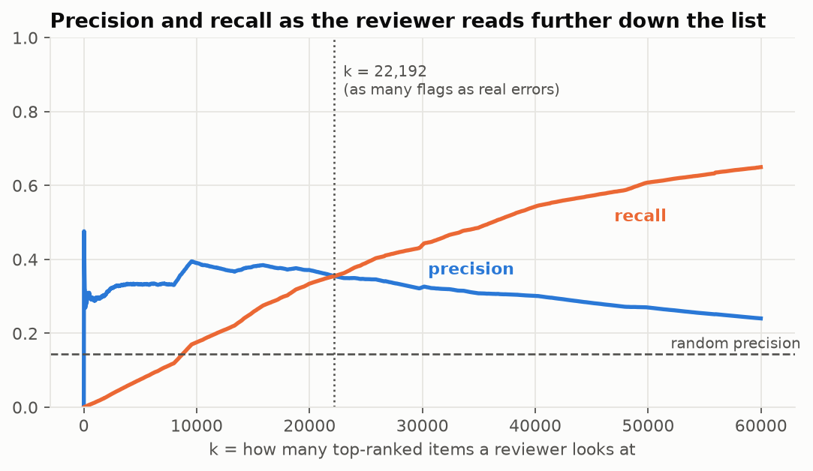

**Detection rate by error type**, using a review budget equal to the number of errors (22,192), and then twice that:

| Mistake | Injected | Found in top 22,192 | Rate (v2) | Rate at 2x budget | Rate (v1) |
|---|---|---|---|---|---|
| Wrong class | 5,551 | 1,966 | **35%** | 49% | 11% |
| Bad box | 5,551 | 2,579 | **46%** | 70% | 32% |
| Fake box | 5,539 | 2,542 | **46%** | 86% | 83% |
| Deleted box | 5,551 | 785 | **14%** | 22% | 0% |

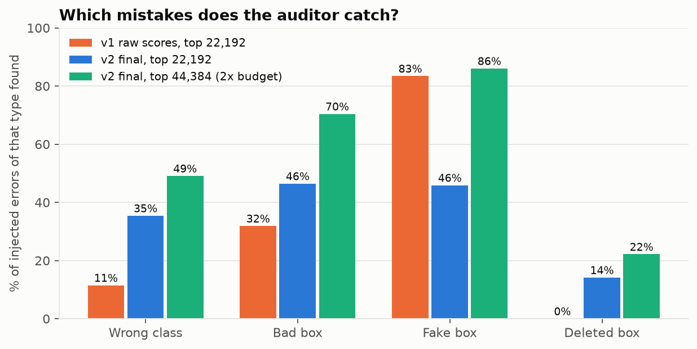

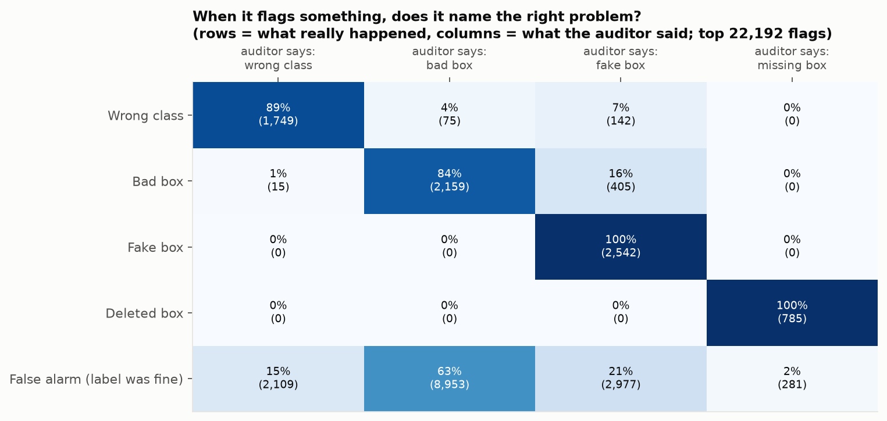

**What the charts say:**
- At a budget of 22,192 reviews, v2 finds 46% of bad boxes, 46% of fake boxes, 35% of wrong classes and 14% of deleted boxes. With twice the budget, fake boxes reach 86%.
- **v2 is a trade-off, not a free win.** v1 actually found *more* fake boxes at the same budget (83%) but almost nothing else, because its "nothing here" score pushed every other error type down the list. v2 spreads attention across all four types and wins overall (AP 0.30 vs 0.25).
- When the auditor does flag something, it usually names the right problem: 89% for wrong class, 84% for bad box, 100% for fake and deleted (matrix above). Its main weakness is false alarms: most of its wrong flags say "bad box", often on small or distant objects.

**Where it does not work:** deleted boxes. The model only proposes a box for 52% of them at all, and most of those are not confident enough to rank high. Also, precision in the very top 100 is only 32%: this is a **triage tool that shrinks a haystack, not an oracle**.

### 6. Does cleaning the labels make a better model?

This is the question a team really cares about. I trained **three detectors with identical settings and the same seed** and tested all of them on the *same clean validation photos*:

- **(a)** trained on the clean labels (the best case),
- **(b)** trained on the noisy labels (the problem),
- **(c)** trained on the noisy labels after the auditor fixed or removed what it flagged: 1,427 labels relabelled to the AI's suggestion and 19,711 removed.

| Training labels | mAP50 | mAP50-95 |
|---|---|---|
| (a) Clean labels | 0.475 | 0.261 |
| (b) Noisy labels | 0.457 | 0.251 |
| (c) Noisy, then auto-cleaned | 0.452 | 0.246 |

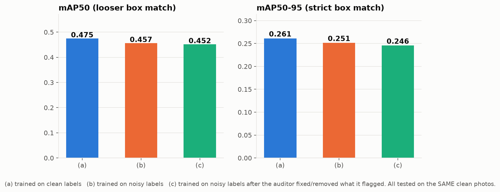

**Auto-cleaning did **not** help: (c) mAP50 0.452 vs (b) 0.457 (-0.005); a difference this small is within what one seed can produce.** Noise itself only cost 0.019 mAP50 (a vs b), so there was little to win back. My best explanation, not tested: only about 35% of what the auditor flags at the top is a real error, so removing flagged labels also deletes a lot of correct ones, which cancels the benefit.

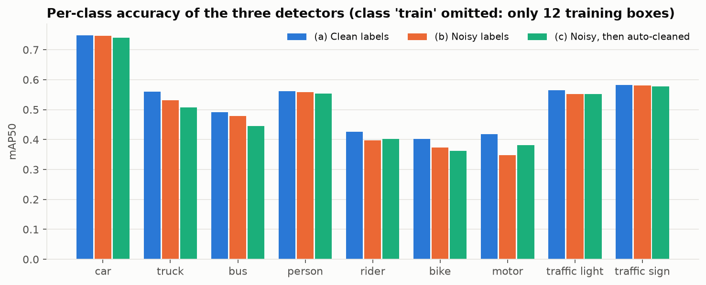

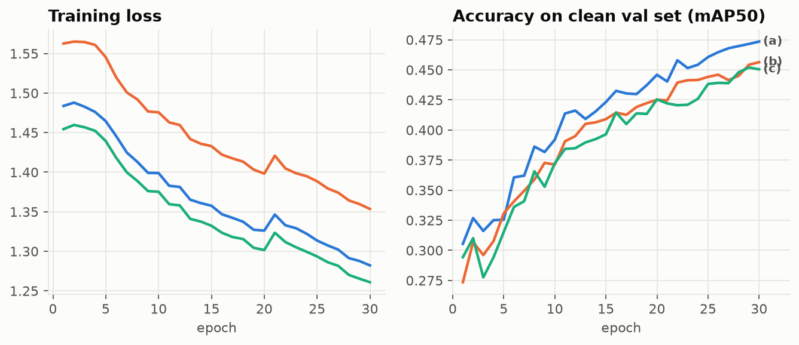

### 7. Auditing the real labels

I then ran the auditor on the **original, uncorrupted** labels and saved the top 100 flagged boxes as crops with the label drawn on them (`results/real_audit/crops/`), a table (`review_queue.csv`) and a simple web page (`review.html`; just open it in a browser).

> **Flagged, unverified.** These are boxes where the auditor *disagrees* with the human label. **None of these is claimed to be a real error.** No human has reviewed them yet.

- Top-100 review queue: **100 boxes**. 2,748 labels score >= 0.99 and 13,251 score >= 0.95 (these are percentile scores, not error counts).
- Sanity check (raw signals, left three charts below): the "confident different class" signal fires on 0.7% of the original labels but 2.1% after I flipped classes (about 3x more), so that signal clearly reacts to damage. The other two barely move (3.0% to 3.4%, and 58.6% to 60.6%) because they are dominated by objects the small detector simply misses. That matches the weak per-type results above.
- Note: v2's percentile scores always put roughly the same share of labels above any cutoff, in any dataset, so they cannot be used for this check. That is why the check uses the raw signals.

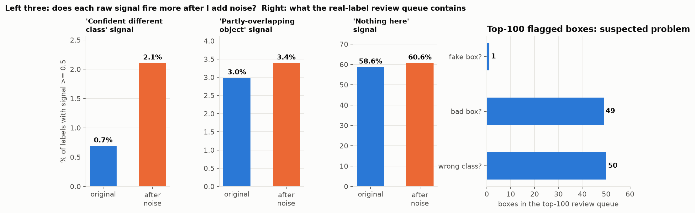

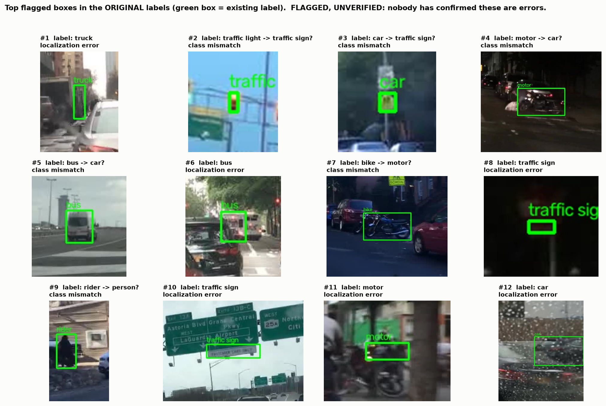

## Honest limitations

- The noise is synthetic and random. Real annotation mistakes are more structured and subtle, so real-world detection rates will differ.
- One random seed per experiment and no confidence intervals. The (b) vs (c) gap of 0.005 is smaller than what seed-to-seed variation could produce.
- The judge detectors are small (YOLO11s, 4,000 photos each, mAP50 about 0.42). Small objects like distant traffic signs are hard for them, which causes false flags.
- I changed the scoring method once (v1 to v2) after seeing results. Both are reported in full.
- The BDD100K copy came from Hugging Face (`dgural/bdd100k`), not the official download (it needs a login). See `DEVIATIONS.md`.
- The 100 real-label flags are **unverified**.

## Run it yourself

```bash
git clone <this repo> && cd driving-label-auditor
bash run_all.sh          # builds .venv, downloads data, runs every stage (~3-4 h on an RTX 5090)
python verify_claims.py  # re-derives the claims in this README from the raw files (48 checks)
```

| Folder / file | What is in it |
|---|---|
| `src/` | One script per stage (`s1_prep.py` ... `s9_visuals.py`), shared code in `common.py`, scoring logic in `scorer.py` |
| `results/` | Raw logs, per-epoch training CSVs, `noise_manifest.csv` (answer key), `label_scores.csv`, evaluation JSONs, real-label review queue |
| `figures/` | Every chart and the demo GIF |
| `report.md` | The longer technical write-up |
| `DEVIATIONS.md` | Everything that differs from the original plan, and why |
| `verify_claims.py` | Independent checks of the numbers and of the "flagged, unverified" wording |

Tech: Python, PyTorch, Ultralytics YOLO11, pandas, scikit-learn, matplotlib, OpenCV.
