# Label Quality Auditor

Finding wrong bounding-box labels in self-driving data, and measuring how well that works when I know exactly which labels are wrong.

[Report](report.md) | [Deviations from the plan](DEVIATIONS.md) | [How to run it](#running-it)

<p align="center">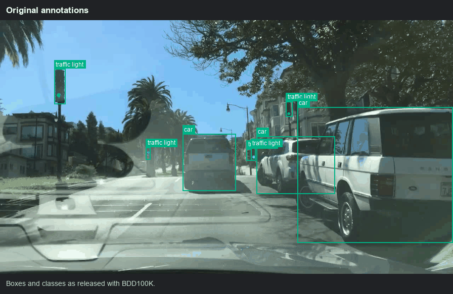</p>

**Figure 1.** One training image going through the pipeline: the original labels, the labels after I corrupted some of them, what a detector that never saw this image predicts, the boxes the auditor flags, and a comparison with the answer key. Green is a correct label, orange a corrupted one, blue a prediction, yellow a flag.

## Summary

A self-driving perception model is only as good as the boxes it was trained on, and people drawing those boxes make mistakes. I wanted to see how well a model can point at those mistakes on its own. The difficulty is that you can't measure that on a normal dataset, because nobody knows which labels are wrong. So I took BDD100K (10,000 images), deliberately broke 15% of the training boxes in four different ways, and trained a YOLO11s detector on the damaged labels. To stop the model from simply agreeing with labels it had memorised, I trained it in two folds and only let each one judge images it had never seen. Every label then gets a suspicion score based on how much the held-out prediction disagrees with it.

Measured against the known errors, the ranking reaches an average precision of 0.298, compared with 0.144 for a random order (2.1x better). If a reviewer looks at as many items as there are injected errors, they find 46% of the jittered boxes, 46% of the spurious boxes, 35% of the class flips and 14% of the dropped boxes. The part that did not work out: removing or relabelling the top-ranked 15% of labels and retraining did **not** help (mAP50 0.452 against 0.457 with the noisy labels and 0.475 with clean ones, one seed). I also ran the auditor on the original labels and saved the 100 most suspicious boxes. Nobody has checked those yet.

## Why this problem

Looking through every label by hand does not scale, so a team needs a short list of boxes worth a second look. To judge whether such a list is any good, you need a case where the wrong labels are known. That is why I inject the errors myself instead of hunting for real ones. The two-fold trick comes from confident learning (Northcutt et al., 2021); here I apply it to box-level detection labels and four kinds of error.

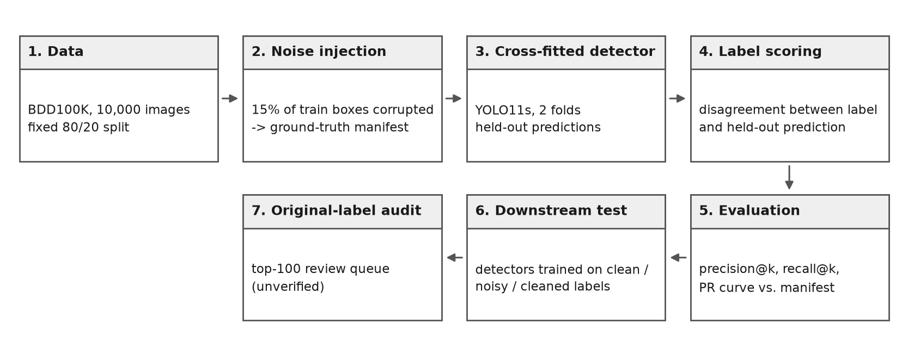

**Figure 2.** The pipeline, from data to the audit of the original labels.

## How it works

### Data

I used the BDD100K detection labels for 10,000 images, taken from a public Hugging Face copy (see `DEVIATIONS.md` for why not the official download). Class names are mapped to ten classes (`pedestrian`, `bicycle` and `motorcycle` become `person`, `bike` and `motor`) and other categories are dropped. A fixed random split gives 8,000 training and 2,000 validation images. The validation labels are never touched.

**Table 1.** Boxes per class.

| class | train | val |
|---|---|---|
| car | 81,911 | 20,926 |
| truck | 3,365 | 878 |
| bus | 1,271 | 389 |
| person | 10,585 | 2,840 |
| rider | 527 | 131 |
| bike | 811 | 228 |
| motor | 369 | 91 |
| traffic light | 21,445 | 5,439 |
| traffic sign | 27,751 | 6,973 |
| train | 12 | 3 |

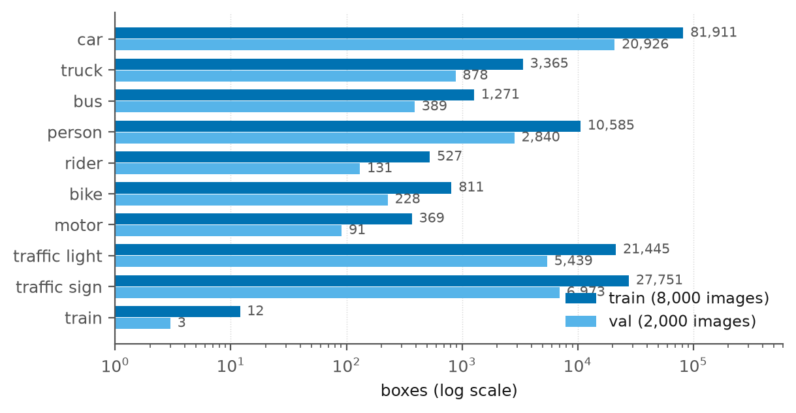

**Figure 3.** Boxes per class on a log scale. Cars and traffic signs dominate. The `train` class has only 12 training boxes, which is too few to learn anything from.

### Breaking the labels

I copied the training labels and corrupted 22,192 of the 148,047 boxes (15.0%), split evenly over four error types. Each change is recorded in `results/noise_manifest.csv`, which serves as the answer key.

**Table 2.** The four error types.

| type | what I do | boxes |
|---|---|---|
| Class flip | the label is swapped for a class it is easily confused with (car/truck, truck/bus, bike/motor, person/rider, traffic light/sign, train/bus) | 5,551 |
| Box jitter | the box centre is moved by 15-40% of the box size and the width and height are rescaled (x0.6-0.8 or x1.25-1.6), so IoU with the original is below 0.7 | 5,551 |
| Spurious box | a new box with a class and size copied from real boxes, placed where it overlaps no existing label (IoU < 0.02) | 5,539 |
| Dropped box | the label is deleted | 5,551 |

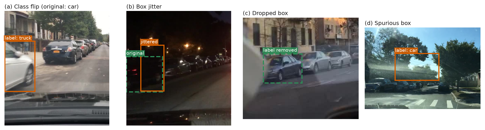

**Figure 4.** One real example of each error. Green dashed is the original box, orange is the corrupted one.

### The cross-fitted detector

I split the training images into two folds. A YOLO11s detector (pretrained on COCO, 30 epochs, image size 640, batch 32, seed 0) is fine-tuned on the noisy labels of one fold and then predicts the other fold, and the same again the other way round. That way no image is ever scored by a model that trained on it, which matters because a model that has seen a wrong label can learn to repeat it.

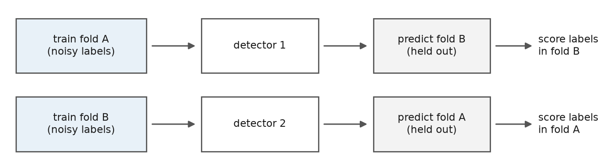

**Figure 5.** Two-fold cross-fitting.

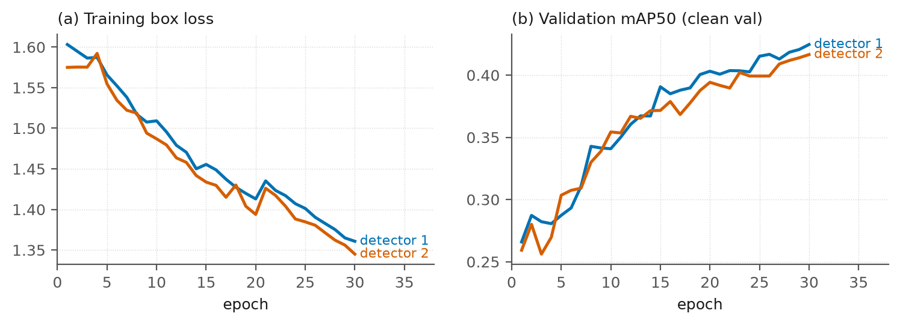

**Figure 6.** Training loss and validation mAP50 for the two detectors (per-epoch logs are in `results/logs/`). They end at mAP50 0.425 and 0.417. Each one only sees 4,000 images, so they are fairly modest judges.

### Scoring the labels

For every label, I look at what the held-out detector predicts around it and compute three signals, plus a list of possible missing labels.

**Table 3.** The signals.

| signal | how it is computed |
|---|---|
| class mismatch | highest confidence of a prediction of a different class with IoU >= 0.5, minus the highest same-class confidence at IoU >= 0.5 (not below 0) |
| localization error | over same-class predictions with 0.1 <= IoU < 0.75, the highest conf x (1 - IoU), times (1 - highest same-class conf at IoU >= 0.75) |
| spurious label | 1 minus the highest confidence of any prediction with IoU >= 0.3 |
| missing label | predictions with conf >= 0.3 that overlap no label (IoU < 0.3), ranked by confidence |

My first version (v1) ranked labels by the largest raw signal. That worked badly, because the spurious signal fired on so many small, hard-to-see objects that it buried everything else. In v2 I turned each signal into a percentile among labels of the same class and size, so they can be compared, and rank by the largest percentile. v2 does not use the answer key, but I chose it after seeing how v1 did, so I report both.

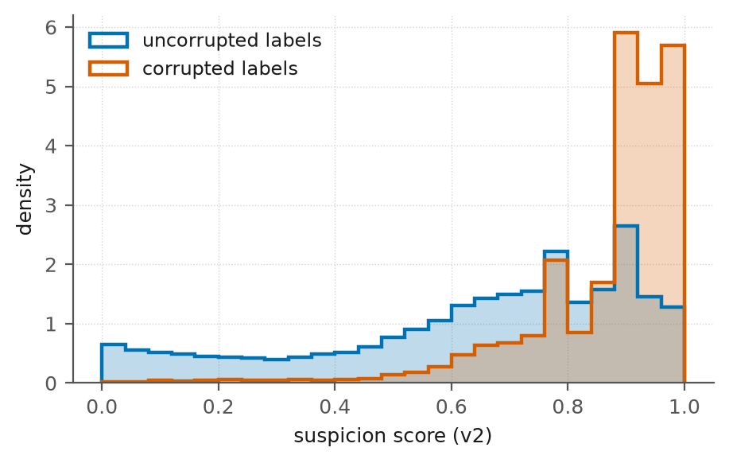

**Figure 7.** v2 suspicion scores for uncorrupted and corrupted labels.

### How I measure it

I rank all 161,696 items (the noisy labels plus the missing-label candidates) by suspicion. A flagged label counts as a hit if it is in the manifest. A missing-label candidate counts as a hit if it overlaps a dropped box with IoU >= 0.5, and each dropped box can only be matched once. Precision@k is the share of the top k items that are real errors, and recall@k is the share of all 22,192 injected errors found within the top k. Average precision (AP) summarises the whole precision-recall curve in one number. I also report how many errors of each type turn up in the top N and top 2N items, where N = 22,192 is the number of injected errors.

## Results

### Finding the injected errors

**Table 4.** Precision and recall of the v2 ranking. A random ranking would have precision 0.144.

| k | precision@k | recall@k |
|---|---|---|
| 100 | 0.320 | 0.001 |
| 500 | 0.300 | 0.007 |
| 1,000 | 0.289 | 0.013 |
| 5,000 | 0.333 | 0.075 |
| 10,000 | 0.390 | 0.176 |
| 22,192 | 0.355 | 0.355 |
| 30,000 | 0.325 | 0.439 |
| 50,000 | 0.270 | 0.608 |

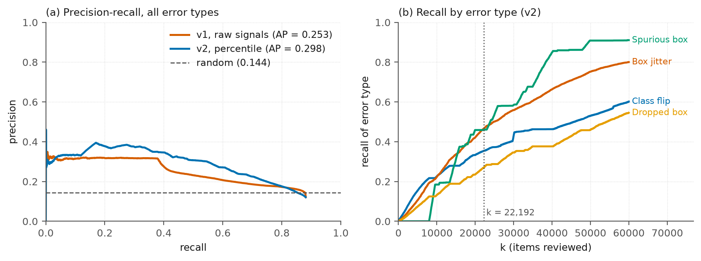

**Figure 8.** (a) Precision-recall curves for v1 and v2. (b) How quickly each error type is found as a reviewer reads further down the v2 list.

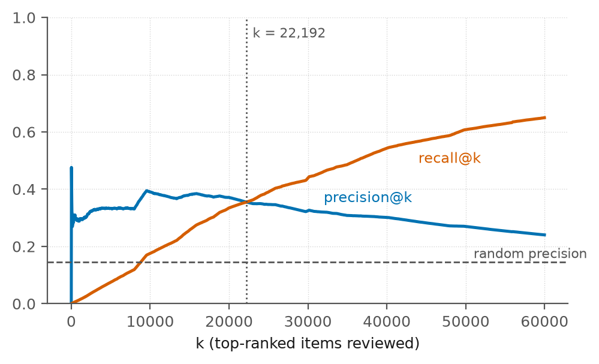

**Figure 9.** Precision@k and recall@k for v2. The dotted line marks k = N.

**Table 5.** Share of the injected errors found, by type.

| type | injected | found in top N | rate (v2) | rate in top 2N (v2) | rate in top N (v1) |
|---|---|---|---|---|---|
| Class flip | 5,551 | 1,966 | 35.4% | 49.1% | 11.5% |
| Box jitter | 5,551 | 2,579 | 46.5% | 70.4% | 31.9% |
| Spurious box | 5,539 | 2,542 | 45.9% | 86.0% | 83.4% |
| Dropped box | 5,551 | 785 | 14.1% | 22.2% | 0.0% |

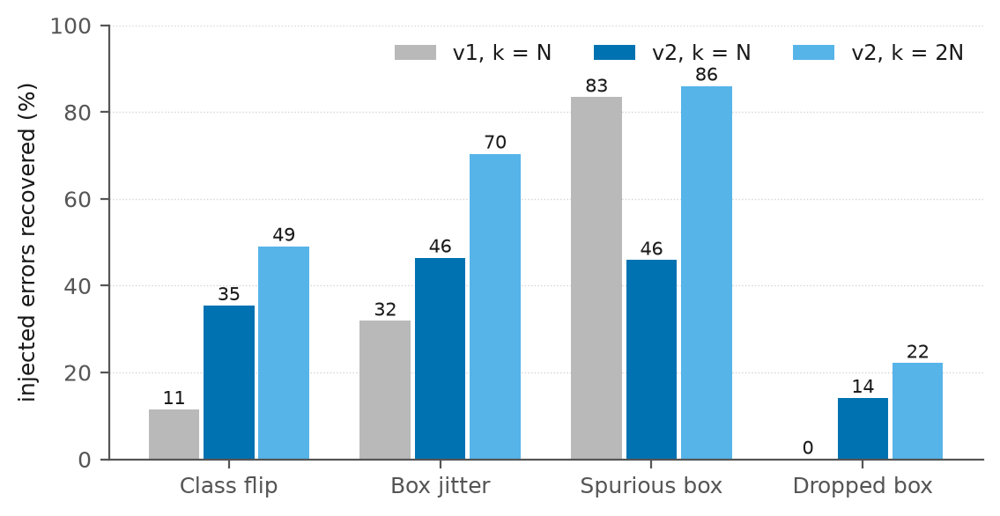

**Figure 10.** Percentage of injected errors found, by type, for v1 (top N) and v2 (top N and top 2N).

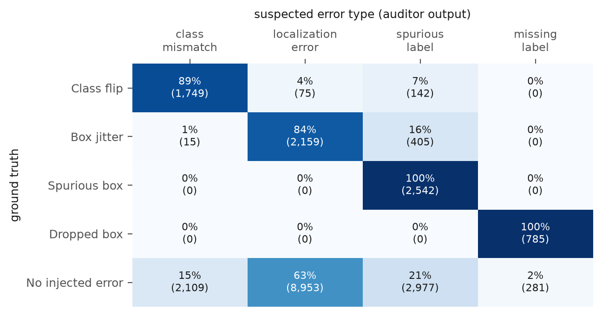

**Figure 11.** What the auditor says (columns) against what actually happened (rows), among the top N items.

v2 beats v1 on average precision (0.298 against 0.253), but it is a trade. v1 found more spurious boxes (83% against 46% in the top N) and very little of anything else, while v2 spreads its attention over all four types. Dropped boxes are the hardest case: the detector only proposes a box that matches for 52% of them, and that caps what can be found. When the auditor flags a real error it usually names the right problem (Figure 11). Its weak spot is false alarms, most of which are labelled localization errors on small or distant objects. Even the top 100 items are only 32% real errors, so I'd treat the ranking as a way to prioritise a review, not as a verdict.

### Does cleaning the labels help the detector?

I trained three detectors with identical settings and seed, and evaluated all of them on the same clean validation set: (a) on the clean labels, (b) on the noisy labels, and (c) on the noisy labels after cleaning. For (c) I took the top 15% of ranked items (a noise budget I assumed, not the true count), relabelled the 1,427 class-mismatch labels to the suggested class and removed the other 19,711 flagged labels.

**Table 6.** Accuracy on the clean validation set.

| training labels | mAP50 | mAP50-95 |
|---|---|---|
| (a) Clean | 0.475 | 0.261 |
| (b) Noisy | 0.457 | 0.251 |
| (c) Noisy + auto-cleaned | 0.452 | 0.246 |

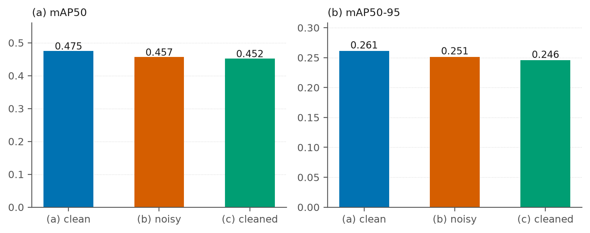

**Figure 12.** mAP50 and mAP50-95 of the three detectors.

Cleaning the labels did **not** help. The cleaned run (c) reached mAP50 0.452 against 0.457 for the noisy run (b), a difference of -0.005. With one seed per run I wouldn't read anything into a gap that small, but it is certainly not an improvement. The noise itself only cost 0.019 mAP50 ((a) against (b)), so there was not much to win back to begin with. My guess, which I have not tested, is that only about a third of the top-ranked items are real errors (Table 4), so removing them throws away many good labels along with the bad ones.

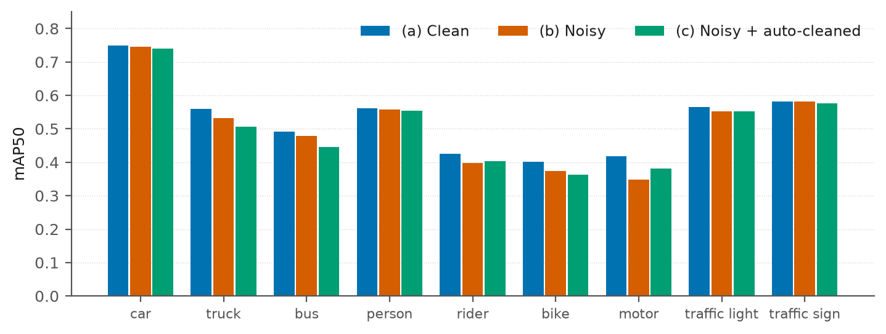

**Figure 13.** mAP50 per class (the `train` class is left out).

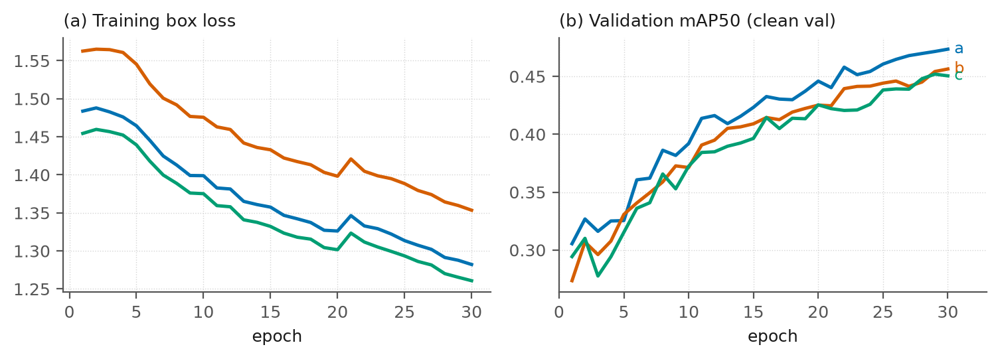

**Figure 14.** Training loss and validation mAP50 of the three downstream detectors.

### The original labels

I also ran the scorer on the original, uncorrupted training labels. The top 100 items are saved as crops with the label drawn on them (`results/real_audit/crops/`), as `review_queue.csv`, and as a simple page, `review.html`, that opens in any browser.

> **Flagged, unverified.** These are boxes where the auditor disagrees with the human label. **None of these is claimed to be a real error.** No person has reviewed them yet.

The queue has 100 boxes: 50 suspected class mismatches, 49 localization errors and 1 spurious label. 2,748 labels score 0.99 or higher and 13,251 score 0.95 or higher, but because v2 scores are percentiles those are not error counts. As a sanity check I compared the raw signals on the original labels with the same signals after I added noise (Figure 15a-c). The class-mismatch signal is at least 0.5 on 0.7% of the original labels and 2.1% of the noisy ones, about 3x more, so it clearly reacts to damage. The localization (3.0% against 3.4%) and spurious (58.6% against 60.6%) signals barely move, because they are dominated by objects the detector simply misses. I can't use the percentile scores for this check, since they come out roughly the same in any dataset.

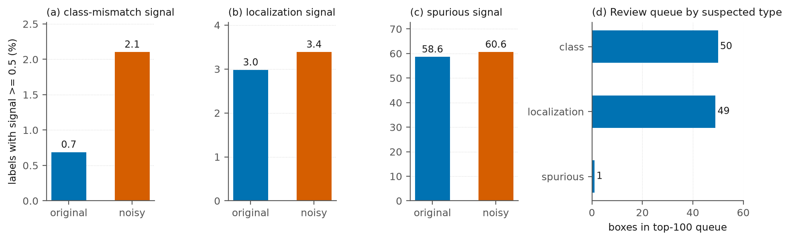

**Figure 15.** (a-c) Share of labels with each raw signal at 0.5 or above, in the original and the noisy label sets. (d) Suspected type of the top-100 queue.

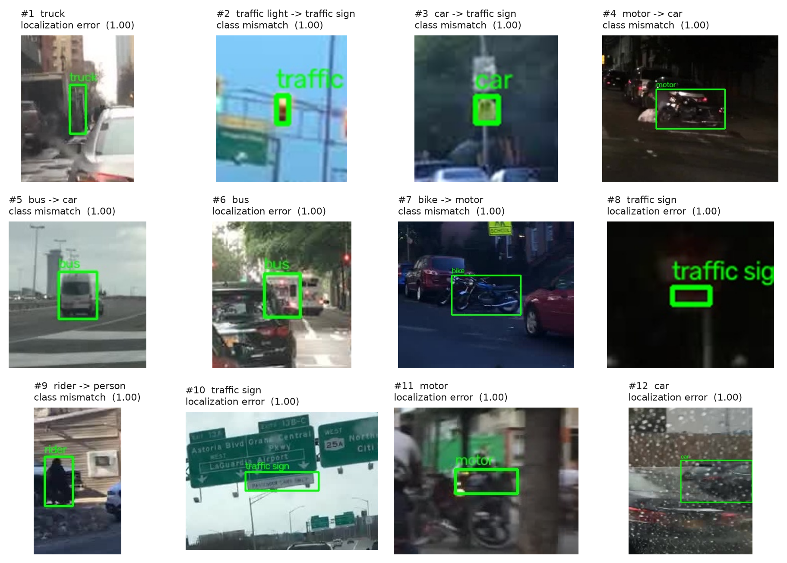

**Figure 16.** The 12 highest-ranked boxes in the original labels (the green box is the existing label). Flagged, unverified.

## Running it

```bash
bash run_all.sh          # creates .venv, downloads the data, runs every stage (about 3-4 h on one RTX 5090)
python verify_claims.py  # recomputes the numbers reported here from the raw outputs
```

`run_all.sh` regenerates the large intermediate files (`crossfit_predictions.csv`, `label_scores*.csv`, `data/`). They are not stored in this repository, and `verify_claims.py` needs them. Each stage is one script in `src/` (`s1_prep.py` to `s9_visuals.py`), with shared helpers in `common.py` and the scoring logic in `scorer.py`.

| path | what is in it |
|---|---|
| `src/` | one script per stage |
| `results/` | logs, per-epoch CSVs, the noise manifest, evaluation JSONs, the review queue |
| `figures/` | every figure, including Figure 1 (the GIF) |
| `report.md` | a longer write-up |
| `DEVIATIONS.md` | where I departed from the original plan, and why |
| `verify_claims.py` | checks the reported numbers and the "flagged, unverified" wording against the raw files |

## References

- F. Yu et al. BDD100K: A Diverse Driving Dataset for Heterogeneous Multitask Learning. CVPR 2020.
- C. G. Northcutt, L. Jiang, I. L. Chuang. Confident Learning: Estimating Uncertainty in Dataset Labels. JAIR 70, 2021.
- Ultralytics YOLO11, https://github.com/ultralytics/ultralytics.
