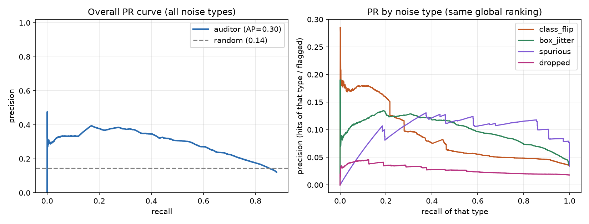
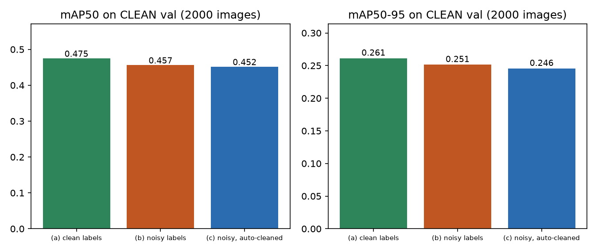
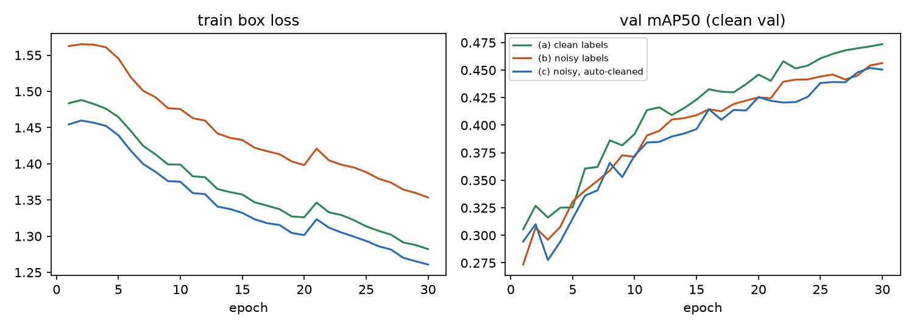
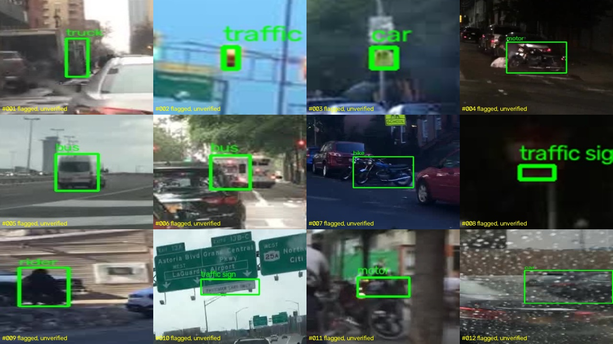

# Report: Label Quality Auditor

## Summary
- A cross-fitted YOLO11s auditor flags suspicious bounding-box labels on BDD100K. Against 22,192 deliberately corrupted boxes (15.0% of 148,047),
  average precision is **0.298** (random ranking: 0.144).
- Quality is moderate and uneven: spurious boxes and jitter ~46-47%, class flips 35%, dropped boxes 14% at a review budget equal to the error count.
- Auto-cleaning did **not** help: (c) mAP50 0.452 vs (b) 0.457 (-0.005); a difference this small is within what one seed can produce.
- The original labels were also audited: the top 100 boxes are queued for manual review, status **flagged, unverified**. We make no claim they are real errors.

## Results
### Does the auditor find the injected errors? (`results/audit_eval.json`)
Ranking is over 161,696 items (all noisy labels + missing-label candidates). Random ranking gives precision 0.144. Average precision = **0.298**.

| top-k flagged | precision | recall |
|---|---|---|
| 100 | 0.320 | 0.001 |
| 500 | 0.300 | 0.007 |
| 1,000 | 0.289 | 0.013 |
| 5,000 | 0.333 | 0.075 |
| 10,000 | 0.390 | 0.176 |
| 22,192 | 0.355 | 0.355 |
| 30,000 | 0.325 | 0.439 |
| 50,000 | 0.270 | 0.608 |

Detection rate by noise type (share of that type inside the top-22,192 flagged, i.e. a review budget equal to the number of errors, and inside the top-44,384):

| noise type | injected | found in top 22,192 | rate | rate at top 44,384 |
|---|---|---|---|---|
| class flip | 5,551 | 1,966 | 35.4% | 49.1% |
| box jitter | 5,551 | 2,579 | 46.5% | 70.4% |
| dropped box | 5,551 | 785 | 14.1% | 22.2% |
| spurious box | 5,539 | 2,542 | 45.9% | 86.0% |

**Where it works:** spurious boxes and box jitter are found at roughly 46-47% at a budget equal to the error count; class flips 35%.
**Where it does not:** dropped (missing) boxes. Only 52% of them are even proposed as candidates by the model, and just
14% are in the top-22,192. Precision at the very top of the list is only ~32%, so it is a triage aid, not an oracle.
The first version (raw, uncalibrated sub-scores) had AP 0.253; v2 was adopted after looking at those results (kept in `results/audit_eval_v1_raw_scores.json`).

### Does cleaning the labels help the detector? (clean val, identical settings and seed 0)
| training labels | mAP50 | mAP50-95 |
|---|---|---|
| (a) clean labels | 0.475 | 0.261 |
| (b) noisy labels | 0.457 | 0.251 |
| (c) noisy, auto-cleaned | 0.452 | 0.246 |

Auto-cleaning did **not** help: (c) mAP50 0.452 vs (b) 0.457 (-0.005); a difference this small is within what one seed can produce. Noise itself cost only 0.019 mAP50 ((a) vs (b)). Cleaning flagged the top 22,205 rows; 1,427 labels were relabelled to the model's suggested class and 19,711 removed.
Removing flagged labels also removes many *correct* labels (precision ~35%), which plausibly cancels the benefit.

  

### Audit of the original labels - FLAGGED, UNVERIFIED
Running the scorer on the original, uncorrupted labels: top 100 flagged boxes saved as crops (`results/real_audit/crops/`, `review_queue.csv`, `review.html`).
2,748 labels score >= 0.99 and 13,251 score >= 0.95 (percentile scores, so these counts are not error counts).
**None of these is claimed to be a real error; nobody has reviewed them yet.** Please review a sample and record verdicts in `review_queue.csv`.

## Why cleaning did not help (hypotheses, untested)
1. About 65% of what the auditor flags at the top is *not* an injected error, so removal deletes many good labels.
2. Injected noise costs only 0.019 mAP50 in this setup, leaving little to recover.
3. One seed per condition; differences of ~0.005 are not distinguishable from noise.

## Next steps
Review a sample of `review_queue.csv` to estimate precision on real errors; repeat stage 6 with 3+ seeds; use a stronger full-data judge; repair labels instead of deleting them.

## Limitations
- Noise is synthetic and uniformly random; real annotation errors are more structured and harder, so detection rates on real errors will differ.
- Single seed, no confidence intervals; the (b) vs (c) gap is smaller than plausible seed variance.
- Cross-fit models train on 4,000 images each (val mAP50 0.425 and 0.417), so they are a weaker judge than a full-data model; small objects (traffic signs/lights) are hard for them, causing false flags.
- Rare classes (`train`: 12 train boxes) are effectively unlearnable; results for them are meaningless.
- The scorer was revised once after seeing evaluation results (v1 to v2); v2 does not use the manifest, but the choice was informed by it.
- Val is used for per-epoch logging only; final weights are last-epoch, no checkpoint selection on val.
- Stage 7 predictions come from models trained on the *noisy* copy (the same cross-fit predictions), then compared with the original labels.
